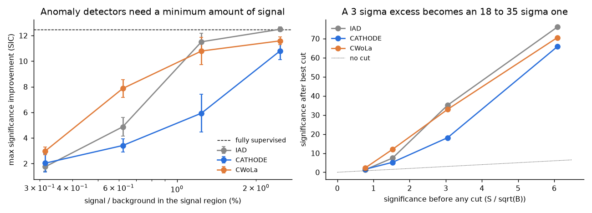
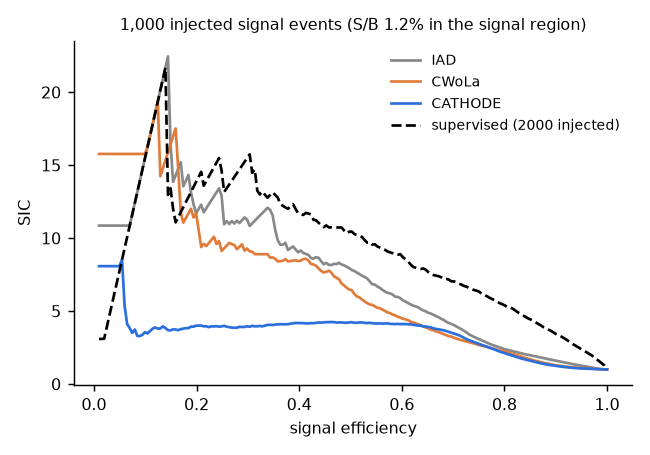

# Finding a needle without knowing what it looks like: anomaly detection on the LHC Olympics data

Most searches for new particles look for one specific signal. Anomaly detection asks a harder question: is there
**anything** in the data that the background does not explain? This project benchmarks three weakly supervised and
density-based methods on the public LHC Olympics 2020 R&D dataset, at signal levels too small to see by eye.

## Data and setup

- 1,000,000 simulated background (QCD dijet) events and 100,000 signal events (a 3.5 TeV W' decaying to X and Y,
  each decaying to two quarks). Five high-level features per event: dijet mass m_jj, the lighter jet mass, the jet
  mass difference, and the two jets' n-subjettiness ratios tau21.
- "Observed" data: 500,000 background events plus a chosen number of injected signal events (0 to 2,000).
- Signal region: 3.3 < m_jj < 3.7 TeV. Evaluation on a separate test set (signal region only).
- Metric: significance improvement characteristic, SIC = signal efficiency / sqrt(background efficiency).
  SIC = 5 means a cut turns a 1 sigma excess into a 5 sigma one.
- Every method ends in the same classifier (an ensemble of 5 boosted-tree models). They differ only in what the
  signal region data are compared against.

| Method | Reference sample | Needs |
|---|---|---|
| Supervised | labelled signal | knowing the signal (upper bound) |
| Idealized anomaly detector (IAD) | a perfect background sample in the signal region | a perfect simulation (not available in practice) |
| CWoLa hunting | data in the neighbouring m_jj sidebands | features not correlated with m_jj |
| CATHODE | samples from a normalizing flow p(features given m_jj) trained in the sidebands and interpolated | a good density estimate |

Each setting was run with 3 seeds. The flows were trained on an NVIDIA GPU on the MSU HPCC (`slurm/lhco.sb`).

## Results

| Signal events injected | 0 | 250 | 500 | 1,000 | 2,000 |
|---|---|---|---|---|---|
| S/B in signal region | 0 | 0.3% | 0.6% | 1.2% | 2.5% |
| S/sqrt(B) before any cut | 0 | 0.8 | 1.5 | 3.0 | 6.1 |
| IAD max SIC | 1.0 | 1.7 | 4.9 | 11.5 | 12.5 |
| CWoLa max SIC | 1.0 | 3.0 | 7.9 | 10.8 | 11.6 |
| CATHODE max SIC | 1.1 | 2.0 | 3.4 | 5.9 | 10.8 |

The fully supervised classifier reaches a max SIC of 12.5.



- **No false discoveries.** With no signal injected, all methods give SIC close to 1, so they do not invent anomalies
  from background alone.
- **A threshold effect.** Below about 0.5% S/B the methods barely help. Around 1% they jump close to the supervised
  limit. A 3 sigma excess (1,000 events) becomes 18 to 35 sigma after the best cut. That number is an optimistic
  upper bound, because the best cut is picked using truth labels on the test set.
- **CWoLa did better than expected here** at low signal levels, even beating the idealized detector at 250 and 500
  events. With these five features the correlation between jet masses and m_jj is weak, which suits CWoLa.
- **My CATHODE underperforms.** In the original paper CATHODE is close to the idealized detector. Here it reaches
  about half of the IAD's SIC at 500 and 1,000 events. The most likely cause is that my flow's background model in
  the signal region is not accurate enough, so the classifier spends capacity on flow mistakes instead of the signal.
  Better density estimation (more epochs, ensembles of flows, a logit transform for the bounded tau21 features) is
  the obvious next step. I did not tune against the test results.



## Reproduce

```bash
pip install -r requirements.txt
# data: events_anomalydetection_v2.features.h5 from https://zenodo.org/records/6466204 into data/raw/
python scripts/run_benchmark.py    # GPU recommended for the flows
python scripts/figures.py
pytest -q
```

References: Kasieczka et al., "The LHC Olympics 2020" (2021); Collins, Howe, Nachman, "Extending the search for new
resonances with machine learning" (CWoLa hunting, 2019); Hallin et al., "Classifying anomalies through outer density
estimation" (CATHODE, 2022).
